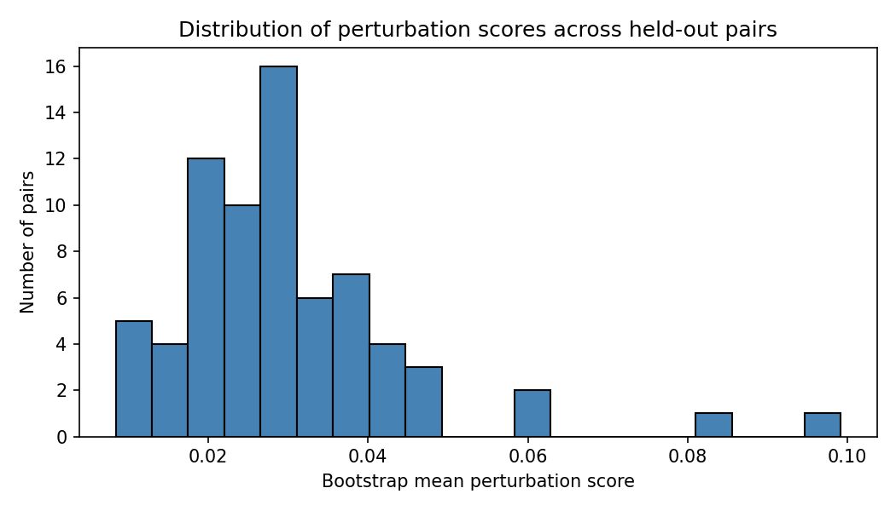
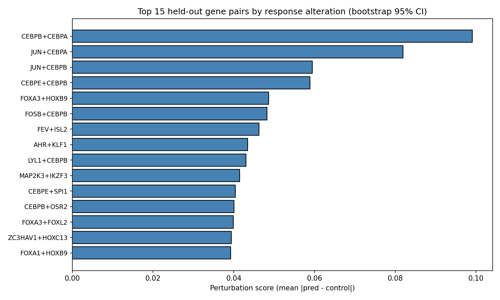

## Prioritize Gene Pairs

> #### Research question:Which held-out gene pairs alter the response most?

### Deliverables
- Ranked pairs
- Error + uncertainty
- Pathway interpretation

### Problem definition
Given a baseline GEARS model trained on single-gene and combinatorial perturbation data, prioritize held-out gene pairs by the magnitude of their predicted transcriptional response alteration. Produce a ranked list of gene pairs with calibrated uncertainty estimates and pathway-level interpretation.

---

A GEARS-based analysis of <mark style="background: #ADCCFFA6;">held-out combinatorial gene perturbations</mark> in the Norman et al. (2019) dataset. The project <mark style="background: #FFF3A3A6;">ranks gene pairs by the magnitude of their predicted transcriptional response relative to control</mark>, <mark style="background: #FFF3A3A6;">estimates variability through control-cell bootstrap resampling,</mark> <mark style="background: #FFF3A3A6;">and provides exploratory Gene Ontology (GO) annotation analysis.</mark>

### Perturbation score

For a gene pair, the score is <mark style="background: #FFF3A3A6;">the mean absolute difference between the predicted combination expression profile</mark> and <mark style="background: #FFF3A3A6;">the control expression profile across measured genes:</mark>

$$
\mathrm{score}(g_i,g_j)=\frac{1}{|G|}\sum_{g\in G}
\left|\widehat{x}_{g_i+g_j,g}-x_{\mathrm{ctrl},g}\right|
$$

A higher score means a larger predicted change from control. <mark style="background: #FFF3A3A6;">It is **not** a synergy score</mark>: the notebook does not compare the combination response against an additive expectation derived from the two single-gene perturbations.

---

  
  

## References

- Norman et al. (2019), *Exploring genetic interaction manifolds constructed from rich single-cell phenotypes*. The notebook uses the Norman perturbation dataset.
- GEARS: the Gene Expression Analysis and Regulation using Systems biology framework used for perturbation response prediction. See the documentation and citation information distributed with the GEARS package used in this project.
