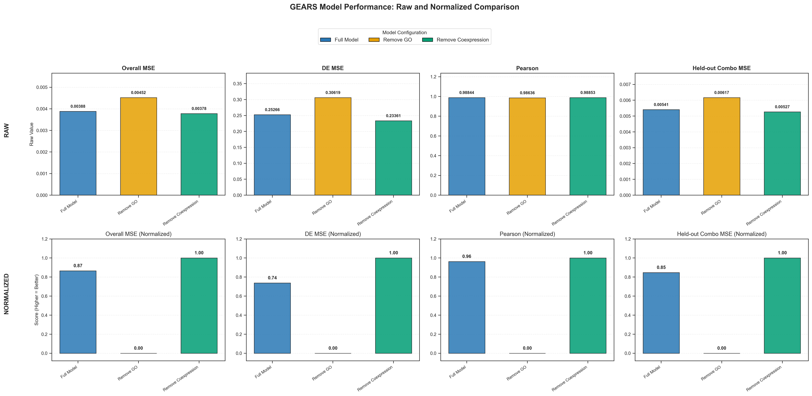

# Does Prior Biology Help?

>  Research question: <mark style="background: #FFB86CA6;">Does prior biology knowledge improve GEARS generalization to held-out combinatorial gene pairs</mark>?

### Deliverables
- <mark style="background: #FFB86CA6;">Three trained GEARS variants (full / remove GO / remove coexpression)</mark>
- Held-out prediction error comparison
- Conclusion on prior biology contribution

### Problem definition

Test whether prior biology knowledge improves GEARS generalization to held-out combinatorial pairs by comparing three model variants: full GEARS (GO + coexpression graphs), GEARS without GO (no functional prior), and GEARS without coexpression (no expression graph). Report held-out prediction error for each.

### Problem info

The baseline GEARS conditions a graph-based gene expression model on two biological graphs: a functional prior derived from Gene Ontology (GO) and an expression graph derived from coexpression. Ablating each graph isolates its contribution to predicting novel multi-gene perturbations. Held-out pairs (never perturbed together in training) measure generalization.

### Solution

Modify the baseline GEARS pipeline as follows:

1. Train three GEARS variants on the same single- and multi-gene perturbation data:
   - **(a)** both graphs (full GEARS)
   - **(b)** coexpression graph only (remove GO)
   - **(c)** GO graph only (remove coexpression)

1. For each held-out combinatorial gene pair, predict the response profile with each variant.
2. Compute held-out prediction error per variant (mean squared error against observed response).
3. Compare error across the three models to quantify the value of each prior.
4. Report whether full GEARS, GO-only, or coexpression-only achieves the lowest held-out error.

## Implementation

The analysis is implemented in `PriorBiology.ipynb`, which trains the three GEARS variants on the Norman perturbation dataset using the `materials/gears/` pipeline:

1. Loads the `norman` perturbation data and prepares a `simulation` split (75% of genes for training; held-out combinatorial pairs in the test set).
2. Trains three variants via `train_variant()`:
   - `full_gears` — `num_go_gnn_layers=1`, `num_gene_gnn_layers=1` (GO + coexpression)
   - `remove_go` — `num_go_gnn_layers=0` (coexpression only)
   - `remove_coexpression` — `num_gene_gnn_layers=0` (GO only)
3. Evaluates each variant on the held-out test set and computes held-out combo MSE plus overall test metrics.
4. Saves each trained model to `models/<variant>/` (`config.pkl` + `model.pt`) and writes `results.json` and `conclusion.txt`.

> **Note:** `torch_geometric` must import successfully. On some macOS setups the prebuilt PyG compiled extensions segfault (`import torch_geometric` crashes); run in an environment where `import torch_geometric` works. If GPU (MPS) runs out of memory, set `DEVICE='cpu'` and reduce `BATCH_SIZE`/`EPOCHS`.

--- 

  

### References

- Norman et al. (2019), *Exploring genetic interaction manifolds constructed from rich single-cell phenotypes*. The notebook uses the Norman perturbation dataset.
- GEARS: Roohani et al. (2023), *Predicting transcriptional outcomes of novel multigene perturbations with gears*. Nature Biotechnology.
