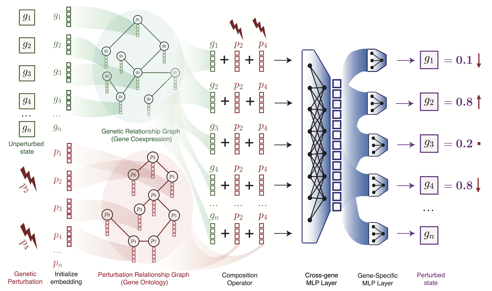

# GEARS: Predicting transcriptional outcomes of novel multi-gene perturbations

This repository hosts the official implementation of GEARS, a method that can predict transcriptional response to both single and multi-gene perturbations using single-cell RNA-sequencing data from perturbational screens. 


<p align="center"></p>


### A note on usage:

- GEARS is currently not designed to handle training across multiple cell types or cross-cell type transfer of predictions
- GEARS has not been tested for training with bulk sequencing data.
- When trained on single-gene perturbation data alone, GEARS cannot reliably predict outcomes for combinatorial perturbations. The model must be trained on some combinatorial perturbation data to make such predictions.
- GEARS has been tested using datasets that contain multiple perturbation types, and multiple cells within each perturbation type. Datasets with too few cells per perturbation or too few perturbations may not work well with our model.


---

### Citation

```
@article{roohani2023predicting,
  title={Predicting transcriptional outcomes of novel multigene perturbations with gears},
  author={Roohani, Yusuf and Huang, Kexin and Leskovec, Jure},
  journal={Nature Biotechnology},
  year={2023},
  publisher={Nature Publishing Group US New York}
}
```
Paper: https://www.nature.com/articles/s41587-023-01905-6


---


### Documentation

GEARS (Genetic Enhancement of Algebraic Response Simulation) predicts transcriptional outcomes of novel **multi-gene perturbations** from single-cell RNA-seq perturbational screens. The model is trained on observed perturbation conditions (single-gene and pairwise combinations) and generalizes to **unseen combinations** of genes by leveraging a gene-gene interaction graph (Gene Ontology / co-expression network).

#### Supported Datasets

| Dataset | Source | Name |
|---|---|---|
| Norman et al. 2019 | immune cells, CRISPRi | `norman` |
| Adamson et al. 2016 | K562, CRISPRi | `adamson` |
| Dixit et al. 2016 | K562, CRISPR | `dixit` |
| Replogle 2022 K562 essential | essential genes, K562 | `replogle_k562_essential` |
| Replogle 2022 RPE1 essential | essential genes, RPE1 | `replogle_rpe1_essential` |

All are loaded via:
```python
from gears import PertData
pert_data = PertData('./data')
pert_data.load(data_name='norman')
```

The underlying raw/anndata file is always `perturb_processed.h5ad`, saved per dataset under `<data_path>/<data_name>/perturb_processed.h5ad`.

---

#### Required Data Format (Your Own Data)

To use GEARS on a custom perturbation dataset, prepare a **scanpy `AnnData` object** (`adata`) with:

| Component | Requirement |
|---|---|
| `adata.X` | Post-perturbed gene expression (dense or sparse matrix), cells × genes |
| `adata.var` | Must contain column `gene_name` with gene symbols |
| `adata.obs` | Must contain columns `condition` and `cell_type` |

### Condition naming convention

`adata.obs['condition']` holds the perturbation name per cell:

| Condition type | Format | Example |
|---|---|---|
| Control | `ctrl` | `ctrl` |
| Single perturbation | `A+ctrl` or `ctrl+A` | `FEV+ctrl` |
| Combination perturbation | `A+B` | `FEV+AHR` |

The code parses conditions by splitting on `+` and treating `ctrl` as the non-perturbed side (see `gears/utils.py:parse_single_pert`, `parse_combo_pert`, `parse_any_pert`).


### Recommended normalization

For raw count data:
```python
sc.pp.normalize_total(adata)
sc.pp.log1p(adata)
sc.pp.highly_variable_genes(adata, n_top_genes=5000, subset=True)
```
GEARS then processes the data (takes ~15 min for 5K genes and 100K cells):
```python
from gears import PertData
pert_data = PertData('./data')
pert_data.new_data_process(dataset_name='dixit', adata=adata)
pert_data.load(data_path='./data/dixit')
```

#### Data Processing Pipeline

`PertData.new_data_process()` / `PertData.load()` performs:

1. **Validation** — requires `condition`, `cell_type` in `adata.obs` and `gene_name` in `adata.var`.
2. **Differential expression (DE)** — `rank_genes_groups_by_cov` computes top DE genes per condition vs control, stratified by `cell_type`, stored in `adata.uns['rank_genes_groups_cov_all']`.
3. **Dropout / non-zero gene annotation** — per condition, marks non-zero genes, true zeros (zero in both perturbed and control), and top-20 non-dropout / non-zero DE genes (stored in `adata.uns`).
4. **Perturbation graph construction** — builds a gene-gene network from Gene Ontology (GO) term overlap (Jaccard > 0.1) or co-expression, saved as `<dataset>/go.csv`.
5. **PyG cell graphs** — each cell becomes a `torch_geometric.data.Data` object; saved to `<dataset>/data_pyg/cell_graphs.pkl`.

Processed data layout (example for `norman`):
```
demo/data/norman/
├── perturb_processed.h5ad   # AnnData object
├── go.csv                   # Gene ontology edge list
├── data_pyg/
│   └── cell_graphs.pkl      # PyG cell graphs per perturbation
└── splits/
    └── norman_simulation_1_0.75.pkl
```

#### Cell Graph Construction

Each cell is converted into a PyG `Data` object (`gears/pertdata.py:create_cell_graph`):

| Attribute | Meaning |
|---|---|
| `x` | Gene expression vector (transposed, shape `[num_genes, 1]`) |
| `y` | Target post-perturbation expression (label) |
| `pert_idx` | Indices of perturbed gene(s) in the gene vocabulary (control → `[-1]`) |
| `de_idx` | Indices of top-20 DE genes for the perturbation |
| `pert` | Perturbation condition string (e.g. `FEV+ctrl`) |

For non-control perturbations, each perturbed cell is paired with `num_samples` randomly sampled control cells as basal expression (`X` = control expression, `y` = perturbed cell expression). Control cells map to themselves (`X = y = control expression`).

Cell graphs are grouped by perturbation condition in `self.dataset_processed` (dict: `condition → list[Data]`).

#### Data Splits

`PertData.prepare_split()` divides perturbation conditions into train / val / test. Splits are saved as pickle files under `<dataset>/splits/`.

### Available split types

| Split | Description |
|---|---|
| `simulation` | Train on a fraction of genes; test on unseen single perturbations and combos partitioned by how many genes were seen during training (combo_seen0 / seen1 / seen2). Default train gene fraction = 0.75. |
| `simulation_single` | Same as simulation but only single-gene perturbations are considered. |
| `combo_seen0` | Test combos where neither gene was seen in training. |
| `combo_seen1` | Test combos where exactly one gene was seen in training. |
| `combo_seen2` | Test combos where both genes were seen in training. |
| `single` | Test on held-out single genes. |
| `no_test` | Train / val only, no test set. |
| `no_split` | All data marked as test. |
| `custom` | User-specified split via `split_dict_path` (`{'train': [...], 'val': [...], 'test': [...]}`). |

### `simulation` split composition (from `gears/data_utils.py:DataSplitter.get_simulation_split`)

Given `train_gene_set_size` fraction of genes sampled for training:
- **Train**: single perturbations on train genes + combo perturbations where both genes are train genes (sampled at `combo_seen2_train_frac`) + `ctrl`.
- **Test subgroups**:
  - `combo_seen0`: combos with 0 train genes
  - `combo_seen1`: combos with exactly 1 train gene
  - `combo_seen2`: remaining combos with 2 train genes (not in train)
  - `unseen_single`: single perturbations on out-of-distro (OOD) genes

Example usage:
```python
pert_data.prepare_split(split='simulation', seed=1)
# train / val / test are stored in pert_data.set2conditions
```

### `set2conditions`

After splitting, `pert_data.set2conditions` is a dict mapping split name → list of conditions:
```python
{'train': [...], 'val': [...], 'test': [...]}
```

#### DataLoaders

`PertData.get_dataloader(batch_size, test_batch_size)` builds PyG `DataLoader`s from the cell graphs grouped by split:

```python
dataloader = pert_data.get_dataloader(batch_size=32, test_batch_size=128)
# keys: 'train_loader', 'val_loader', 'test_loader'
```

- Train loader: `shuffle=True`, `drop_last=True`.
- Val / test loaders: `shuffle=False`.
- `node_map` (gene name → index) is rebuilt from `adata.var.gene_name`.

#### Gene Ontology / Perturbation Graph

GEARS uses a gene-gene interaction graph to propagate perturbation effects across genes:

- **Default graph**: downloaded Gene Ontology annotation (`gene2go_all.pkl` from Harvard Dataverse). Edge weight = Jaccard similarity of GO term sets, filtered at > 0.1.
- **Custom graph**: provided via `gene_set_path` or inferred from co-expression on training data (`network_type='co-express'`).
- Filtered to `pert_names` — genes that appear in GO and in the perturbation set. Perturbations whose genes are not in the GO graph cannot be predicted and are reported at load time.

Files: `<data_path>/gene2go_all.pkl`, `<data_path>/essential_all_data_pert_genes.pkl`, `<dataset>/go.csv`.

